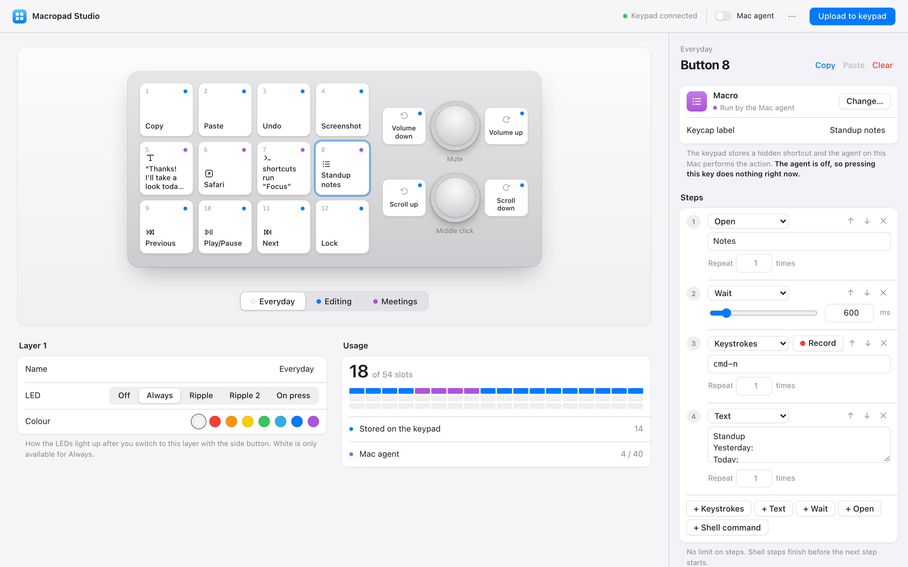

# Macropad Studio

A configurator for the cheap **CH57x-based macro keypads** sold on AliExpress and Amazon
(12 keys + 2 knobs, USB ID `1189:8840`, and relatives). The vendor software is Windows-only and
can't even show you the current mapping. Macropad Studio gives you a native-feeling editor and a key
recorder — and on a Mac, a small background agent that lets a key do things the keypad hardware
can't: type any text, open apps, run shell commands, or play back multi-step macros.

**[Open the web app →](https://elniakim.github.io/macropad-studio/)** Nothing to install: plug in the
keypad, open the page in Chrome or Edge (macOS, Windows, Linux, ChromeOS) and upload.

<picture>
  <source media="(prefers-color-scheme: dark)" srcset="docs/screenshot-dark.png">
  
</picture>

## Features

- **Visual editor** for all 3 layers: 12 keys and 2 knobs (turn left, press, turn right). Drag keys to
  swap them, copy and paste slots, and set each layer's LED mode and colour.
- **Key recorder** — press a shortcut on your keyboard and it's captured.
- **Everything the hardware supports**: key sequences, media keys, mouse click/scroll/move/drag, and
  the original tool's expression syntax for power users.
- **Agent actions** for what the hardware can't do (see below): type any Unicode text (emoji,
  Korean, …), open apps, URLs and files, run shell commands, and macros with per-step waits and repeats.
- Light and dark mode; English and Korean UI (follows your browser language).
- A CLI that reads the original tool's YAML format.

## Web app or Mac app?

| | [Web app](https://elniakim.github.io/macropad-studio/) | Mac app (this repo) |
|---|---|---|
| Install | None | Python + `pip install` |
| OS | Any, in Chrome / Edge / other Chromium browsers | macOS |
| Keys, media, mouse, LEDs, layers | ✓ | ✓ |
| Text, open apps/URLs, shell, multi-step macros | — | ✓ (Mac agent) |
| Where your mapping is kept | This browser (export/import as JSON) | `state/` in the repo folder |

Both use the same editor and the same encoder, and **Export / Import mapping** in the ··· menu moves
a mapping between them. The web app talks to the keypad with [WebHID](https://developer.mozilla.org/docs/Web/API/WebHID_API):
Chrome asks you to pick the keypad once, and the page can only reach the device you picked. Safari
and Firefox don't support WebHID.

### Linux: allow your browser to reach the keypad

Linux only lets root open raw HID devices, so Chrome lists the keypad but can't write to it until
you add a udev rule. `uaccess` grants access to whoever is logged in at the machine, rather than
making the device writable by every account:

```sh
sudo tee /etc/udev/rules.d/70-macropad-studio.rules >/dev/null <<'RULES'
SUBSYSTEM=="hidraw", ATTRS{idVendor}=="1189", ATTRS{idProduct}=="8840|8842|8850", TAG+="uaccess"
SUBSYSTEM=="hidraw", ATTRS{idVendor}=="514c", ATTRS{idProduct}=="8851", TAG+="uaccess"
RULES
sudo udevadm control --reload-rules && sudo udevadm trigger
```

Then unplug and replug the keypad. macOS, Windows and ChromeOS need no setup.

## What has been tested

Tested on real hardware:

- Keypad `1189:8840` with 12 keys and 2 knobs (the common AliExpress model)
- macOS 26 on Apple silicon, with the Mac app (Python 3) and the web app (Chrome)
- Uploads from both apps, confirmed by pressing the keys afterwards, and every agent action type

Expected to work but **not tested**, because they rely on the original tool's protocol notes rather than
hardware we have:

- The other IDs (`1189:8842`, `1189:8850`, `514c:8851`)
- Other layouts (3, 6 or 15 keys; 1, 3 or 4 knobs). The editor currently shows 12 keys + 2 knobs only
- The web app on Windows, Linux and ChromeOS, and in Edge, Brave, Arc or Opera

Keypads with a different protocol (often sold as "ch57x-2" or with only 3 keys and one knob) aren't
supported. If yours works, or doesn't, please [open an issue](https://github.com/elniakim/macropad-studio/issues)
with the output of `python macropad.py list`, or the name Chrome shows when you connect the keypad.

## Requirements (Mac app)

- macOS (tested on macOS 26, Apple silicon) and Python 3.10+
- A keypad that speaks the "ch57x-1" protocol: `1189:8840`, `1189:8842`, `1189:8850` or `514c:8851`.
  Run `python macropad.py list` to check.

## Quick start (Mac app)

```sh
git clone https://github.com/elniakim/macropad-studio.git
cd macropad-studio
python3 -m venv .venv
.venv/bin/pip install -r requirements.txt
.venv/bin/python server.py
```

`server.py` opens the editor in your browser using a private link
(`http://127.0.0.1:8757/#token=…`); keep using that link or bookmark it. Pick a key, choose what it
should do, then press **Upload to keypad** — it takes well under a second.

The CLI accepts the original tool's YAML format:

```sh
.venv/bin/python macropad.py list
.venv/bin/python macropad.py validate mapping.yaml
.venv/bin/python macropad.py upload mapping.yaml --dry-run   # print the USB packets
.venv/bin/python macropad.py led 0 "backlight blue"
```

## What the hardware can and can't do

| | Limit |
|---|---|
| Layers | 3, switched with the button on the side. Each layer has its own LED mode |
| Slots | 12 keys + 2 knobs × (left, press, right) = 18 per layer, 54 in total |
| Key sequence | Up to 18 steps of "modifiers + one key". One delay (0–6000 ms) applies between *all* steps |
| Media | One HID Consumer usage per slot — volume, playback, brightness, or any raw code |
| Mouse | Click (any button combination), scroll ±127, move/drag ±127 px; at most one modifier (control, shift or option — no command) |
| Not possible | Typing text, a different wait per step, repeats, hold vs. tap, launching apps |

Hardware actions live on the keypad and work on any computer, with or without this app.
The keypad can't report its current mapping, so every upload rewrites all 54 slots; empty slots
are cleared rather than left with whatever was there before.

## The Mac agent

For everything in the "not possible" row, Macropad Studio stores a **hidden trigger chord** on the
keypad (for example ⌃⌥⇧⌘F16) and runs a small agent (`agent.py`) that catches that chord with a
Quartz event tap, swallows it so no app sees it, and performs the real action.

- Toggle it with **Mac agent** in the toolbar. Agent slots do nothing while it's off, and only work on
  the Mac running it.
- Up to 40 agent slots (F13–F20 combined with five 3–4-modifier sets). Those chords are reserved,
  so a hardware key can't be set to one of them.
- The app that launches the agent (Terminal, iTerm, …) needs **Accessibility** permission:
  System Settings → Privacy & Security → Accessibility.
- Use **Run test** in the editor to try an agent action without touching the keypad.

## Security

### Mac app

The editor can make your Mac run shell commands, so the local server is locked down:

- It listens on `127.0.0.1` only and checks the `Host` and `Origin` headers, so other websites (and
  DNS-rebinding tricks) can't reach it.
- Every API call must carry a random token stored in `state/token` (mode `0600`, inside a `0700`
  directory). Other user accounts, sandboxed apps and containers that can reach localhost still can't
  drive it. An empty or truncated token file is replaced, never treated as "no token".
- Writes must be `application/json`, which forces a CORS preflight that is never approved; pages
  can't be framed (`frame-ancestors 'none'`).
- Mappings are validated against a strict schema before they're saved, and everything the UI
  renders is escaped. Request bodies are capped at 4 MB.
- The agent passes "open" targets to `open` as arguments, never through a shell, and refuses ones that
  would read as options (a leading `-`).

What remains is the point of the feature: a mapping's shell actions run as you. **Only use mappings you
wrote or trust.** Importing a mapping that contains shell commands or "open" actions shows every one
of them and asks before accepting it. The agent sees key events in order to catch its trigger chords, but only acts on —
and only logs — those chords.

### Web app

- It's a static page with no backend: your mapping never leaves the browser, and the page can't run
  anything on your computer. The worst a tampered mapping can do is set the keypad's keys.
- WebHID only reaches the device you pick in Chrome's chooser, and the page only asks for the vendor
  configuration interface of the supported keypads.
- A strict Content Security Policy allows no inline or third-party scripts and no requests to other
  sites; the page refuses to run inside a frame.
- The GitHub Actions that deploy it are pinned to commit SHAs and run with the minimum permissions.

Report security problems privately through
[GitHub's security advisories](https://github.com/elniakim/macropad-studio/security/advisories/new)
rather than in a public issue.

## How it works

The keypad exposes a vendor HID interface (usage page `0xFF00`, report ID 3). Configuration is a
series of 64-byte reports: one bind report per slot, plus a short commit sequence and optional LED
reports. On macOS that interface belongs to the system's HID driver, so this project uses **hidapi**
rather than libusb, and runs every hidapi call on one long-lived thread (hidapi's macOS backend is
tied to the run loop of the thread that first loads it).

```
ui/index.html ──JSON──▶ server.py ──compile──▶ macropad.py ──hidapi──▶ keypad
                            │
                            └─ state/device.json ──▶ agent.py (Quartz event tap)
```

| File | Role |
|---|---|
| `macropad.py` | Protocol encoder, expression parser, mapping schema and compiler, CLI |
| `server.py` | Local web server and JSON API |
| `ui/index.html`, `ui/app.js` | The editor, no build step. Local mode on `127.0.0.1`, WebHID mode anywhere else |
| `ui/ch57x.js` | The encoder ported to JavaScript for the web app; tests check it matches `macropad.py` byte for byte |
| `agent.py` | Runs agent actions when trigger chords arrive |
| `state/` | Your draft, the last uploaded mapping and the API token (git-ignored) |

## Development

```sh
.venv/bin/pip install -r requirements-dev.txt
.venv/bin/python -m pytest -q
```

The tests check the encoder byte-for-byte against the original tool's test vectors, check that the
JavaScript encoder produces exactly the same bytes as the Python one (needs `node`), and cover the
schema, the trigger-chord rules and the agent's text chunking. To try the web mode locally, serve
`ui/` with any static server and open `index.html?web`. `MACROPAD_STATE` and `MACROPAD_PORT`
let you run a second instance against a scratch state directory.

## Credits

The keypad protocol was reverse-engineered by
[kriomant/ch57x-keyboard-tool](https://github.com/kriomant/ch57x-keyboard-tool) (MIT). The encoder in
`macropad.py` and `ui/ch57x.js` are ports of its `ch57x-1` (k884x) driver; see [`LICENSE`](LICENSE).

## License

[MIT](LICENSE)
